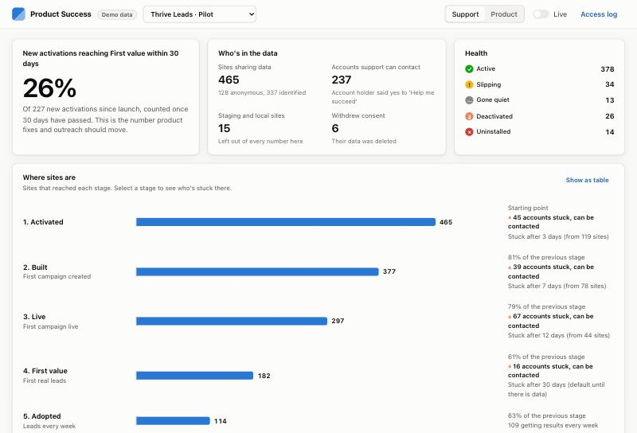
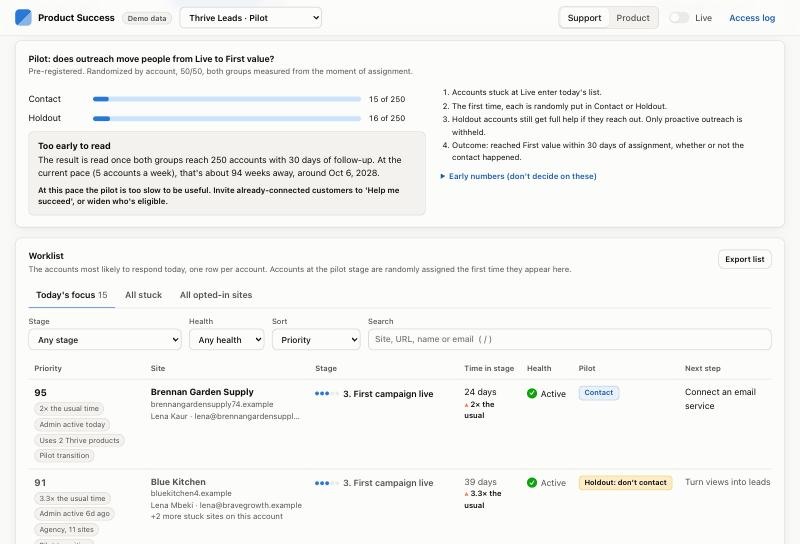
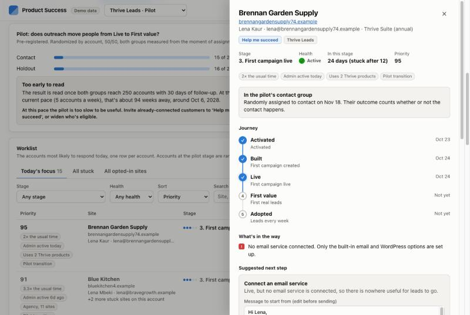
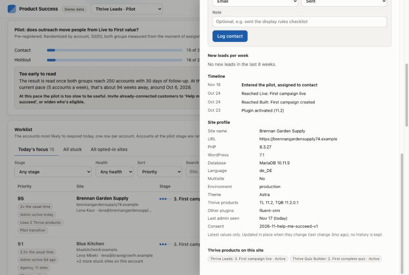

# Product Success Platform

## Goal

Know which stage every customer site is at in every Thrive product, and give support a short daily list of the customers they can actually help move forward.

* One five-stage ladder for every product (Activated, Built, Live, First value, Adopted), so everyone speaks the same language.
* A site profile that always shows the latest site name, PHP version, WordPress version and other setup details, updated in place.
* A support console: who's stuck, why, what to say, and a record of every contact.
* A built-in pilot that measures whether outreach works, against customers nobody contacted.
* Product managers get real adoption numbers in Metabase, without seeing anyone's name or email.

## User Story

As a **support team member**, I want a short, prioritized list of customers who are stuck and likely to respond, with what's in their way and a message to start from, so that my time goes where it moves people forward.

As a **product manager**, I want to see where customers stall in each product, so that I can fix the step that loses the most people instead of guessing.

As a **customer**, I want to choose whether Thrive sees my setup progress, and to know exactly what that means, so that any help I get is welcome and nothing is collected behind my back.

## Design

🚧 Figma pending. Until then, the [working demo](demo/README.md) is the design reference. Screenshots below are from it, with invented data.

## Specs

### User journey context

* **The customer** installs a Thrive product, activates it, and connects their Thrive account during onboarding. That's where they're asked about "Help me succeed." Most people want to get a campaign or course live quickly; they're not thinking about data sharing, so the ask must be short, honest, and easy to decline.
* **Support** starts the day in the console's "Today's focus" list, works through it, and logs what they did. They also look customers up when a ticket comes in.
* **Product managers** read the funnel in Metabase to decide what to fix next. They never need contact details.

---

### Part 1: What we track

#### The stage ladder

Every product maps its own moments onto the same five stages. Stage is the furthest a site has ever got, so it never goes backwards.

| # | Stage | Means |
|---|---|---|
| 1 | Activated | The product is turned on, on a real (production) site |
| 2 | Built | The customer made the first real thing |
| 3 | Live | That thing is in front of real visitors |
| 4 | First value | It produced the outcome they bought it for |
| 5 | Adopted | The outcome keeps coming, week after week |

#### Thrive Leads (first product)

| Stage | Counted when | Notes |
|---|---|---|
| Activated | Thrive Leads is turned on | |
| Built | The first campaign is created | Drafts count. "Created" means they tried. |
| Live | **A real visitor first sees a campaign** | Not when it's saved as published: campaigns are saved as published the moment they're created. The site owner previewing their own campaign doesn't count. |
| First value | **Leads come from at least two different people** | Email sign-ups only, not button clicks. One isn't enough, because most owners test their own form, often logged out. |
| Adopted | New leads in at least 3 of the last 4 weeks | |

#### Other products (proposed, each owner signs off before it ships)

| Product | Built | Live | First value | When |
|---|---|---|---|---|
| Thrive Apprentice | First course with a lesson | Course published | First student enrolled | Wave 2 |
| Thrive Quiz Builder | First complete quiz | First quiz seen by a visitor | First quiz completed | Wave 2 |
| Thrive Ultimatum | First campaign | Campaign running | First conversion | Wave 3 |
| Thrive Optimize | First test | Test started | Test finished with a winner | Wave 3 |
| Thrive Automator | First automation | Automation active | First successful run | Wave 3 |
| Thrive Ovation, Architect, Theme Builder, Comments | | | Needs a product decision on what "value" means | Later |

#### Health

Stage says how far a site got. Health says whether it's still there.

| Health | Shown when |
|---|---|
| ✓ Active | The site checked in within the last 10 days |
| ! Slipping | It reached First value before, but has had no results for 30 days |
| … Gone quiet | No check-in for more than 10 days |
| ‖ Deactivated | The product is turned off but still installed |
| × Uninstalled | The product was removed |

Health is always shown as icon, label and color together, never color alone.

#### When is someone "stuck"?

Stuck means "in the current stage longer than usual, while still active." "Usual" is learned from real data: the point after which customers rarely move on by themselves. Until there's enough data, these defaults apply:

| Moving from | To | Stuck after |
|---|---|---|
| Activated | Built | 3 days |
| Built | Live | 7 days |
| Live | First value | 14 days |
| First value | Adopted | 30 days |

#### Site profile

One record per site. When a value changes, the record is overwritten in place. **No history is kept.**

| Field | Example | Tier | Notes |
|---|---|---|---|
| Site name | Lumen Pottery | Help me succeed only | |
| Site address | lumenpottery.example | Help me succeed only | |
| PHP version | 8.3.27 | Both | Flagged when below Thrive's minimum (8.1), or on 8.1, which no longer gets security updates |
| WordPress version | 7.1 | Both | Flagged when 2 or more versions behind the newest we see |
| Database version | MariaDB 10.11 | Both | |
| Thrive product versions | Thrive Leads 11.2 | Both | Flagged when 2 or more releases behind |
| Language | en_US | Both | |
| Multisite | No | Both | |
| Environment | production, staging or local | Both | Staging and local sites are left out of every number |
| Theme | Thrive Theme Builder | Both | |
| Other relevant plugins | WooCommerce, WP Rocket | Both | A short list of plugins that matter to us (page builders, caching, email and CRM, competitors). Never the full list. |
| Last admin seen | 3 days ago | Both | A strong sign of whether anyone will read an email |
| Connected Thrive account | (account ID) | Help me succeed only | Name, email and plan come from our own account records. The site never sends an email address. |
| Consent given | Help me succeed, version and date | Both | |

The profile updates right after a WordPress update, and whenever a daily check notices a change, such as a new PHP version.

#### What we never collect

* Anything about the customer's own visitors, including the leads they capture
* Form contents, passwords, API keys, webhook addresses
* The full plugin list

---

### Part 2: Consent

#### Two tiers

| Tier | What's shared | Who can say yes | Default |
|---|---|---|---|
| Anonymous product data | Versions, counts and stages, with no name, address or account. This is today's promise and it doesn't change. | Any site admin | Off |
| Help me succeed | Adds site name, address and the connected Thrive account, and **lets our team contact you** | The **account holder** only | Off |

#### Where it's asked

During onboarding, when the customer connects their Thrive account, and as a setting in their Thrive account. Customers who connected before this ships see one dismissible invitation in Thrive Dashboard.

#### Copy (draft, legal must approve)

> **Want our team's help getting results?**
>
> Share your setup progress with Thrive Themes. We'll see your site's name and address, which Thrive products you use, how far you've got with each (for example, whether your first campaign is live), and your PHP and WordPress versions. When it looks like you're stuck, our support team may email you with help.
>
> We never see your visitors or the leads you collect.
>
> [ **Yes, help me succeed** ]   [ No thanks ]
>
> You can change this anytime in Thrive Dashboard settings. [See exactly what we share]

Settings toggle label: **Help me succeed.** Helper text: *"Share your setup progress so the Thrive team can help you. We may email you when you seem stuck."*

---

### Part 3: The support console

#### Entry

* Support opens the console from the internal tools menu. It lands on the product they last used, on **Today's focus**.
* The header holds the product picker, the **Support** / **Product** role switch, a **Live** toggle that refreshes every few seconds, and **Access log**.

#### Summary

* **Hero number:** "New activations reaching First value within 30 days." The one number the whole effort exists to move.
* **Who's in the data:** sites sharing data (anonymous vs. identified), accounts support can contact, staging and local sites left out, and how many customers withdrew consent.
* **Health:** a count for each health state. Selecting one filters the list.

#### Where sites are

* One bar per stage, in stage order, all in one color. Length shows how many sites reached that stage.
* Beside each bar: share of the previous stage, how many accounts are stuck and can be contacted, and when "stuck" starts (and whether that comes from data or the default).
* Selecting a stage opens **All stuck**, filtered to that stage. Selecting it again clears the filter.
* **Show as table** shows the same numbers as a table.

#### The pilot

Shown for the pilot product only. See Part 4.

* Two progress bars, Contact and Holdout, toward the planned size.
* Until the planned size is reached: **"Too early to read"**, with the current pace and a projected finish date. If the pace means the pilot would take more than six months, it says so plainly.
* **Early numbers (don't decide on these)** is collapsed by default.

#### Worklist

**Tabs**

| Tab | Shows |
|---|---|
| Today's focus | The 15 accounts most likely to respond today, one row per account |
| All stuck | Every contactable account past the usual time for its stage, one row per account |
| All opted-in sites | Every production site whose account holder opted in |

**Filters** (one row, above the list): Stage, Health, Sort (**Priority** or **Recently active**), Search (site, address, name or email). **Clear filters** appears when any filter is set. On Today's focus, filters only narrow what's shown; they never change who is on the list.

**Columns**

| Column | Content |
|---|---|
| Priority | Score, plus the reasons behind it as small chips, for example "2× the usual time", "Admin active today", "Agency, 11 sites" |
| Site | Site name, address, account holder's name and email, and "+N more stuck sites on this account" when relevant |
| Stage | Stage number and this product's name for it, with five dots showing progress |
| Time in stage | Days, and how that compares to usual. A "+" means "at least," for customers whose earlier dates we don't time. |
| Health | Icon and label |
| Setup | PHP and WordPress versions, flagged when outdated (moves into site detail on narrower screens) |
| Pilot | **Contact**, or **Holdout: don't contact** |
| Next step | The suggested action, and when they were last contacted |

**Priority** favors customers likely to respond, not just customers at risk:

* How far past the usual time they are. This peaks around twice the usual time and fades after, because someone who stalled last week is likelier to respond than someone who stalled four months ago.
* Whether an admin was in the dashboard recently. No admin for 30+ days pushes a customer down the list.
* Agencies and customers using several Thrive products move up: one conversation helps many sites.
* Renewal date is deliberately **not** used. That would turn "help me succeed" into retention outreach, which isn't what customers agreed to.

**Actions:** selecting a row opens Site detail. **Export list** downloads the current list with account IDs and stages, never names or emails.

#### Site detail

Opens as a panel on the right. Sections, top to bottom:

1. **Header:** site name, address, account holder, plan, "Help me succeed" badge, agency badge, product.
2. **Facts:** stage, health, days in this stage (and when stuck starts), priority, and the reasons.
3. **Pilot notice:** in the contact group since a date; or **"Holdout: don't contact them first"** with "If they reach out, help them normally."
4. **Journey:** the five stages with the date each was reached, "Not yet," or "before opt-in."
5. **What's in the way:** specific blockers, for example "No email service connected," "A campaign is set to display, but no real visitor has seen it in 5 days," "PHP 8.1 stopped getting security updates at the end of 2025," "WordPress 6.8.3 is 3 versions behind 7.1." If none: "Nothing blocking that we can see."
6. **Suggested next step:** a title, why it matters, and a message to start from that's filled in with this customer's details and meant to be edited. Buttons: **Copy message**, then the contact form.
7. **Results per week:** the last 8 weeks (for Leads, new leads). If none: "No new leads in the last 8 weeks."
8. **Timeline:** milestones reached, activation and deactivation, contacts logged, pilot assignment.
9. **Site profile:** every profile field, with "Latest values only. Updated in place when they change; no history is kept."
10. **Thrive products on this site,** each with its stage and health, and **Other sites on this account.**

#### Logging a contact

| Field | Type | Required | Options |
|---|---|---|---|
| Channel | Select | Yes | Email (default), Chat, Call, Ticket reply |
| Outcome | Select | Yes | Sent (default), Replied, Call booked, No response, Not interested |
| Note | Text | No | Up to 2,000 characters. Placeholder: "Optional, e.g. sent the display rules checklist" |

Button: **Log contact.** On success: toast "Contact logged," and the entry appears at the top of the timeline.

#### States

| State | What the user sees |
|---|---|
| Loading | The current view stays on screen, slightly faded, until the new data arrives. No spinners, no layout jump. |
| Empty list | "Nobody is stuck right now. Every contactable account is within the usual time for its stage." |
| No filter matches | "No sites match these filters. Try a different stage or health, or clear the filters." with **Clear filters** |
| No results chart | "No new leads in the last 8 weeks." |
| Server unreachable | Error toast: "Can't reach the server," and the last view stays on screen |
| Contact logged | Toast: "Contact logged" |
| Message copied | Toast: "Message copied" |
| Export | Toast: "Exported. The file has account IDs and stages, no contact details." |

#### Error messages

| When | Message |
|---|---|
| Logging contact for a holdout account | "This account is in the pilot holdout. Help them if they reach out, but don't contact them first." |
| The account holder didn't opt in | "The account holder hasn't agreed to be contacted." |
| Product role tries to log contact | "Only the support role can log outreach." |
| Channel or outcome missing | "Pick a channel and an outcome." |
| Note too long | "Keep the note under 2,000 characters." |

#### Permissions and access

| Role | Sees | Can |
|---|---|---|
| Support | Names, emails, site addresses | Everything: log contacts, export, view the access log |
| Product | Pseudonymous site IDs and account IDs only, the same as Metabase. A note explains this. Search is off. | Read everything else; can't log contacts |

* Every look at a customer's details and every export goes into the **Access log**, once per person, per site, per 30 minutes.
* Customers who withdraw consent disappear from the console. Only a count remains.

#### Micro-interactions

* Hovering a funnel bar or a week's result shows its exact numbers. Every number in a tooltip is also on the page somewhere.
* With **Live** on, a row that moves up a stage briefly highlights, with a toast: "Lumen Pottery moved to 3. First campaign live."
* Keyboard: **/** focuses search, **Enter** opens a row, **Esc** closes the panel or the access log.

#### Mobile and smaller screens

The console works on a laptop first. On narrower screens the summary stacks, the Setup column moves into Site detail, and the list scrolls sideways inside its card rather than the whole page.

---

### Part 4: The pilot

The pilot answers one question before we invest in outreach at scale: does contacting stuck customers actually move them forward?

| | |
|---|---|
| Product and stage | Thrive Leads, Live to First value |
| Who's randomized | Accounts (so an agency's sites never end up in both groups) |
| When | The first time an account appears in Today's focus at that stage |
| Split | 50/50, Contact or Holdout |
| Measured from | The moment of assignment, for both groups, whether or not the contact happened |
| Result | Share that reached First value within 30 days |
| Size | About 250 accounts per group, to detect a jump from 15% to 25% |
| Read | Once, at the planned size |

Holdout accounts still get full support when they reach out. Only proactive outreach is withheld.

## Validation & Edge Cases

### ⚠️ Owners testing their own product

When the site owner previews their own campaign while logged in:
→ It doesn't count as Live.

When the owner tests their own form while logged out:
→ It counts as one person. First value needs two different people.

**Rationale:**
Almost everyone tests their own setup. Counting it would make First value meaningless.

### ⚠️ Existing customers who opt in

When a site that's been using the product for a while opts in:
→ It reports where it already is, marked "before opt-in." Those dates show in the journey but are never used to work out how long stages usually take.

When a site opts in within a day of activating, with nothing built yet:
→ It counts as a new activation, with its real date.

**Rationale:**
Consent is always asked after activation. Without the second rule, no new activation would ever be timed.

### ⚠️ The same milestone reported twice

When a site sends a milestone it already sent (a retry, a reinstall, a restored backup):
→ Nothing changes. The site keeps its first date, and the timeline shows it once.

**Rationale:**
"First" has to mean first, even when the site itself has forgotten.

### ⚠️ Staging and cloned sites

When a site is copied to a new address (a staging copy, a migration):
→ The copy is treated as a new site.

When a site is marked or looks like staging or local:
→ It's left out of every number and every list.

**Rationale:**
A staging copy shouldn't claim the real site's first conversion.

### ⚠️ PHP or WordPress changes

When a site upgrades PHP or WordPress:
→ The profile shows the new version within a day (right away for WordPress updates). The old value is overwritten, not kept.

**Rationale:**
What the team needs is what the customer is running now. History was considered and left out on purpose; see Open Questions.

### ⚠️ Consent withdrawn

When a customer turns off "Help me succeed":
→ Collection stops immediately, their identified data is deleted, and they disappear from the console. Only a count of withdrawals remains.

### ⚠️ Agencies and many-site accounts

When one account has many sites:
→ The list shows one row per account, with "+N more stuck sites on this account." The account holder is who gets contacted, not the agency's clients.

### ⚠️ Holdout accounts

When support opens a holdout account:
→ No ready-to-send message is shown, and **Log contact** is disabled with "Holdout accounts are not contacted first."

When a holdout customer writes in:
→ Support helps them normally.

**Rationale:**
Copying a ready message is the easiest way to contaminate the experiment by accident.

### ⚠️ Duplicated, imported and draft campaigns

When a campaign is duplicated, imported from a template, or never published:
→ It still counts as Built. All three are real first-time use of the campaign builder.

### ⚠️ Quiet, low-traffic sites

When a site gets so little traffic that its scheduled tasks rarely run:
→ Admin visits to the dashboard also trigger sending, and every weekly check-in repeats the milestones reached, so a lost one is recovered.

### ⚠️ Wrong clocks

When a site's clock is far off:
→ We also record when we received each event, and flag big gaps as a data-quality issue rather than dropping the event.

## Success Criteria

### Tracking

- [ ] A site shares nothing until someone opts in, and nothing identified until the account holder opts in to "Help me succeed."
- [ ] Each Thrive Leads milestone is recorded exactly once per site, even after retries, reinstalls and restored backups.
- [ ] The owner previewing their campaign doesn't make it Live; one test sign-up doesn't make it First value.
- [ ] Upgrading PHP or WordPress updates the existing profile within a day, with no duplicate record.
- [ ] Turning off "Help me succeed" removes the site from the console and deletes its identified data.
- [ ] Nothing about tracking adds any load time for the customer's visitors.

### Console

- [ ] Support can open Today's focus, open a customer, copy a message, and log a contact in under a minute.
- [ ] Every "stuck" number in the funnel matches the number of rows in the filtered list.
- [ ] The Product role never sees a name, email or site address anywhere, including exports.
- [ ] Every look at a customer's details and every export appears in the access log.
- [ ] Holdout accounts can't be logged as contacted, and show no outbound message.

### Outcomes

- [ ] The share of new activations reaching First value within 30 days is visible per product, and is the main number we report.
- [ ] The pilot gives a clear yes or no on outreach for Live to First value, at the planned size.

## Out of Scope

* Charts and dashboards for product managers inside the console. Those live in Metabase.
* Sending email from the console, and syncing lists to an email tool. Export is the hand-off for now.
* Showing stage inside the helpdesk sidebar. Planned once the pilot shows outreach works.
* Automated nudges (in-product or email) for the long tail. Same condition.
* Products other than Thrive Leads, until each owner signs off its stages.
* Any change to the existing anonymous tracking promise.
* History of profile values.

## Open Questions

- [ ] **Legal:** does the draft "Help me succeed" copy cover collecting and contacting? What are the retention periods for raw events, stages and identified data, and after withdrawal?
- [ ] **Awesome Motive:** does a shared usage service already exist (behind WPForms' and MonsterInsights' tracking) that we should join instead of building our own?
- [ ] **Thrive Leads owner:** do shortcodes, ThriveBoxes and one-click signups count as campaigns for Built and Live?
- [ ] **Thrive Leads owner:** is "leads from two different people" the right First value, or is one real lead enough?
- [ ] **Support lead:** who works the pilot, and how many contacts a day is realistic?
- [ ] **Everyone:** will we want PHP and WordPress history later, for example to check whether upgrading correlates with reaching First value? The profile keeps only the latest values today.
- [ ] **Thrive Automator:** it's listed on WordPress.org, has its own consent screens, and isn't part of the shared consent today. How does it join?
- [ ] **Supply:** today's opt-in rate is unknown. If it's low, the pilot will take too long to be useful. Can we measure it before building, and plan a re-invite for already-connected customers?
